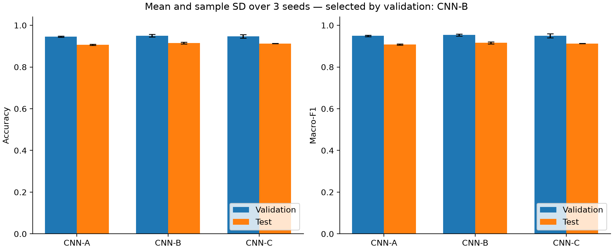

# Nhận dạng hoạt động con người bằng CNN

Triển khai mạng nơ-ron tích chập một chiều (1D CNN) để nhận dạng hoạt động từ cảm biến điện thoại thông minh trên bộ dữ liệu **UCI HAR**. Dự án phục vụ môn **Phương pháp nghiên cứu khoa học trong Khoa học dữ liệu**, kết hợp phân tích công trình của Ronao & Cho (2016), thực nghiệm có thể tái lập và đánh giá khả năng khái quát hóa sang người tham gia mới.

Phần huấn luyện được trình bày trực tiếp trong **Jupyter Notebook**, từ xử lý tín hiệu đến xây dựng mô hình, `model.fit()`, lưu checkpoint và phân tích kết quả.

## Tổng quan

Dự án giải quyết bài toán phân loại sáu hoạt động: **đi bộ, lên cầu thang, xuống cầu thang, ngồi, đứng và nằm**. Ba cấu hình CNN có độ sâu khác nhau được đánh giá trên cùng cách chia dữ liệu và ba random seed.

Các thành phần chính:

- Xử lý chín kênh tín hiệu cảm biến, giữ đúng liên kết giữa cửa sổ, nhãn và người tham gia.
- Chia fit-train, validation và test theo người; chuẩn hóa chỉ bằng thống kê fit-train.
- Huấn luyện CNN-A, CNN-B và CNN-C với early stopping và checkpoint theo validation loss.
- Đánh giá Accuracy, Macro-F1, Precision/Recall/F1 từng lớp, confusion matrix và hiệu quả theo người.
- Lưu cấu hình, lịch sử, dự đoán và dấu kiểm tra SHA-256 để truy nguyên kết quả.

Đây là **tái hiện một phần** hướng tiếp cận của Ronao & Cho. Kiến trúc, quy trình huấn luyện và đầu vào chín kênh của dự án khác thiết lập sáu kênh được mô tả trong bài báo gốc.

## Kết quả thực nghiệm

Kết quả trên **2.947 cửa sổ test chính thức** của UCI HAR:

| Phương pháp | Số tham số | Accuracy test | Macro-F1 test |
|---|---:|---:|---:|
| Baseline lớp phổ biến nhất | — | 18,22% | 0,0514 |
| CNN-A | 7.494 | 90,69% ± 0,31 | 0,9082 ± 0,0030 |
| **CNN-B** | **36.294** | **91,53% ± 0,45** | **0,9161 ± 0,0046** |
| CNN-C | 85.574 | 91,26% ± 0,08 | 0,9127 ± 0,0009 |

Các kết quả CNN là **trung bình ± độ lệch chuẩn mẫu** qua ba seed `42`, `123`, `2026`; độ lệch chuẩn Accuracy được biểu diễn bằng **điểm phần trăm**. Đây không phải khoảng tin cậy giữa các người tham gia. Baseline luôn dự đoán lớp nằm, được xác định từ fit-train.

**CNN-B được chọn theo Macro-F1 validation trung bình trước khi đánh giá test.** Cặp ngồi–đứng có số lỗi hai chiều lớn nhất ở cả ba seed CNN-B. Hiệu quả chênh lệch giữa những người test cho thấy cần xem xét khả năng khái quát hóa bên cạnh chỉ số tổng thể.



Số liệu nguồn: [kết quả từng lượt](results/metrics_per_run.csv), [bảng tổng hợp](results/metrics_summary.csv) và [phân tích thực nghiệm](report/chuong_4_5_ket_qua.md).

## Dữ liệu và thiết kế đánh giá

[UCI HAR](https://archive.ics.uci.edu/dataset/240/human+activity+recognition+using+smartphones) chứa tín hiệu của 30 người thực hiện sáu hoạt động với smartphone. Dự án sử dụng các chuỗi đã được bộ dữ liệu lọc nhiễu và phân cửa sổ.

| Thuộc tính | Giá trị |
|---|---|
| Tần số lấy mẫu | 50 Hz |
| Chiều dài cửa sổ | 128 thời điểm, tương đương 2,56 giây |
| Mức chồng lấn cửa sổ | 50% |
| Đầu vào CNN | `(N, 128, 9)` |
| Thứ tự kênh | Gia tốc cơ thể X/Y/Z → vận tốc góc X/Y/Z → gia tốc tổng X/Y/Z |
| Nhãn mô hình | `0–5`, chuyển từ nhãn nguồn `1–6` |

| Tập | Số người | Số cửa sổ | Vai trò |
|---|---:|---:|---|
| Fit-train | 17 | 5.982 | Fit chuẩn hóa và cập nhật trọng số |
| Validation | 4 | 1.370 | Early stopping và lựa chọn cấu hình |
| Test | 9 | 2.947 | Đánh giá cuối trên người được giữ lại |

Validation gồm các ID **5, 11, 19, 26** trong train chính thức. Không có người trùng nhau giữa ba tập. Mean và standard deviation được tính riêng cho từng kênh trên fit-train, sau đó áp dụng nguyên trạng cho validation và test.

Các tệp `X_train.txt` và `X_test.txt` chứa **561 đặc trưng tính sẵn**; đầu vào CNN được đọc từ thư mục `Inertial Signals`. Chín kênh tín hiệu không đồng nghĩa với chín trục cảm biến vật lý độc lập.

## Kiến trúc và cấu hình huấn luyện

| Mô hình | Phần tích chập |
|---|---|
| CNN-A | Conv1D 64 / kernel 5 → MaxPool 2 |
| CNN-B | Conv1D 64 / kernel 5 → MaxPool 2 → Conv1D 128 / kernel 3 |
| CNN-C | Conv1D 64 / kernel 5 → MaxPool 2 → Conv1D 128 / kernel 3 → Conv1D 128 / kernel 3 |

Mọi lớp Conv dùng ReLU và padding `same`. Phần phân loại chung:

```text
GlobalAveragePooling1D → Dense 64 ReLU → Dropout 0,3 → Dense 6 Softmax
```

| Tham số | Giá trị |
|---|---|
| Optimizer | Adam |
| Learning rate | 0,001 |
| Batch size | 64 |
| Epoch tối đa | 50 |
| Loss | Sparse categorical cross-entropy |
| Early stopping | Validation loss, patience 8 |
| Checkpoint | Trọng số tại validation loss thấp nhất |
| Random seed | 42, 123, 2026 |

Mỗi lượt khởi tạo lại mô hình và optimizer. Việc tăng độ sâu cũng làm thay đổi số tham số và receptive field; so sánh ba cấu hình không cô lập hoàn toàn tác động của riêng độ sâu.

## Cài đặt

Môi trường tham chiếu: **Python 3.12**, **TensorFlow 2.21.0**, huấn luyện trên **CPU**. Thực hiện các lệnh sau từ thư mục gốc dự án với Python 3.12:

```powershell
python -m venv .venv
.\.venv\Scripts\python.exe -m pip install -r requirements.txt
```

[requirements.txt](requirements.txt) chỉ định các thư viện chính; [requirements-lock.txt](requirements-lock.txt) lưu toàn bộ phiên bản của môi trường tham chiếu. Có thể dùng tệp lock để cài đúng các phiên bản đó.

Dữ liệu cần được đặt theo cấu trúc:

```text
Dataset/
└── UCI HAR Dataset/
    ├── activity_labels.txt
    ├── README.txt
    ├── train/
    │   ├── Inertial Signals/
    │   ├── y_train.txt
    │   └── subject_train.txt
    └── test/
        ├── Inertial Signals/
        ├── y_test.txt
        └── subject_test.txt
```

## Huấn luyện bằng notebook

Mở [02_har_training.ipynb](notebooks/02_har_training.ipynb) trong trình soạn thảo hỗ trợ Jupyter, chọn kernel `.venv/Scripts/python.exe` và chạy các ô theo thứ tự. Notebook chứa trực tiếp mã xử lý dữ liệu, định nghĩa CNN, compile, callbacks, `model.fit()`, nạp checkpoint và vẽ learning curves; không phụ thuộc các hàm huấn luyện trong `har_project`.

### Các chế độ thực thi

| `RUN_MODE` | Chức năng |
|---|---|
| `"inspect"` | Mặc định; xem dữ liệu, kiến trúc, lịch sử và kết quả đã lưu |
| `"smoke"` | Kiểm tra pipeline với CNN-B, seed 42, một epoch |
| `"train"` | Huấn luyện các cấu hình trong `MODELS` với danh sách `SEEDS` |

Ví dụ cấu hình huấn luyện mô hình cơ sở:

```python
RUN_MODE = "train"
RUN_NAME = "cnn_b_run01"
MODELS = ["cnn_b"]
SEEDS = [42, 123, 2026]
```

Để so sánh cả ba kiến trúc, đặt `MODELS = ["cnn_a", "cnn_b", "cnn_c"]`. Để chạy thử một epoch, chọn `RUN_MODE = "smoke"`.

Sau khi chỉnh cấu hình, **Save → Restart Kernel → Run All**. Nếu dữ liệu đặt ở vị trí khác, cập nhật `DATA_DIR` trong ô cấu hình.

### Đầu ra huấn luyện

Mỗi đợt được lưu vào `notebook_runs/RUN_NAME/`, gồm:

- Snapshot notebook trên đĩa và SHA-256, cấu hình thực thi và phiên bản môi trường.
- Index chia tập và thống kê chuẩn hóa.
- Kiến trúc, checkpoint `model.keras` và lịch sử `history.csv` của từng seed.
- Dự đoán, xác suất lớp, classification report và chỉ số validation.
- Learning curves của lượt minh họa.

`RUN_NAME` phải khác tên đợt đã tồn tại. Notebook chỉ ghi đầu ra mới bên trong `notebook_runs/`; phần huấn luyện không nạp tín hiệu hoặc nhãn test. Các lượt `smoke` được đánh dấu riêng và không tham gia kết quả thực nghiệm chính.

[01_har_experiment.ipynb](notebooks/01_har_experiment.ipynb) cung cấp giao diện kiểm tra bộ thực nghiệm gốc, xác minh cache và đọc kết quả validation/test đã khóa.

## Tái chạy pipeline bằng dòng lệnh

Giao diện CLI hỗ trợ xử lý dữ liệu, huấn luyện, khóa lựa chọn mô hình và đánh giá cuối. Ví dụ chạy một đợt độc lập trong `results_reproduction/`:

```powershell
# Chuẩn bị dữ liệu và chuẩn hóa theo fit-train
.\.venv\Scripts\python.exe -m har_project prepare --output results_reproduction

# Huấn luyện ba cấu hình với ba seed mặc định
.\.venv\Scripts\python.exe -m har_project train --prepared results_reproduction/prepared/dataset.npz --output results_reproduction --models cnn_a cnn_b cnn_c

# Chọn mô hình theo validation và khóa checkpoint trước test
.\.venv\Scripts\python.exe -m har_project freeze --output results_reproduction

# Đánh giá test một đợt với các checkpoint đã khóa
.\.venv\Scripts\python.exe -m har_project evaluate --output results_reproduction

# Xác minh các tệp và tính lại chỉ số từ dự đoán đã lưu
.\.venv\Scripts\python.exe -m har_project verify --output results_reproduction
```

Bộ kết quả tham chiếu trong `results/` được bảo vệ bằng [protocol lock](results/protocol_lock.json) và [dấu kiểm tra kết quả](results/test_evaluation_status.json). Để xác minh bộ này:

```powershell
.\.venv\Scripts\python.exe -m har_project verify
```

Lệnh `verify` không chạy lại huấn luyện hoặc suy luận. Để xác minh nguyên vẹn trên máy khác, cần đủ checkpoint, cache và các tệp được lock tham chiếu. Checkpoint, cache chuẩn bị và các đợt notebook được bỏ qua trong Git; chỉ clone mã nguồn không thay thế việc chuyển các hiện vật đó.

Các thay đổi mô hình nảy sinh sau khi xem test cần được ghi nhận là phân tích khám phá và đánh giá bằng một thiết kế phù hợp; không dùng cùng test để liên tục điều chỉnh siêu tham số.

## Kiểm thử

```powershell
.\.venv\Scripts\python.exe -m unittest discover -s tests -v
```

Các kiểm tra bao phủ liên kết kênh/nhãn, chia dữ liệu theo người, chuẩn hóa train-only, chỉ số đủ sáu lớp, đầu ra mô hình, bảo toàn kết quả, lựa chọn theo validation, tính toàn vẹn của lock và hành vi thực thi notebook.

Xuất các hình báo cáo từ kết quả đã lưu và xác minh:

```powershell
.\.venv\Scripts\python.exe scripts/plot_report_figures.py
```

## Cấu trúc dự án

```text
SGU26_PPNCKH_Group/
├── Dataset/                 # UCI HAR và tài liệu mô tả dữ liệu
├── Paper/                   # Các công trình tham khảo
├── notebooks/
│   ├── 01_har_experiment.ipynb
│   ├── 02_har_training.ipynb
│   └── 03_practical_questions.ipynb
├── har_project/             # Pipeline dữ liệu, CNN, CLI và đánh giá
├── tests/                   # Kiểm thử dữ liệu, mô hình và notebook
├── results/                 # Kết quả tham chiếu, dự đoán và protocol lock
├── notebook_runs/           # Đầu ra các đợt huấn luyện bằng notebook
├── practical_results/       # Thực nghiệm cảm biến và phân tích câu hỏi thực tế
├── report/                  # Nội dung báo cáo và hình minh họa
├── docs/research/           # Protocol và phân tích tài liệu
├── scripts/                 # Công cụ xuất hình báo cáo
├── requirements.txt
└── requirements-lock.txt
```

## Tài liệu nghiên cứu

[Notebook câu hỏi thực tế](notebooks/03_practical_questions.ipynb) phân tích khả năng nhận dạng người mới, lỗi ngồi–đứng và vai trò của các nhóm tín hiệu cảm biến. Phần cảm biến dùng CNN-B với năm biểu diễn đầu vào, ba seed và cùng validation tách theo người. Mã huấn luyện được trình bày trực tiếp trong notebook.

- `inspect` (mặc định): xác minh và đọc đợt đã lưu trong `practical_results/sensor_study_v1/`, không huấn luyện hoặc ghi lại hiện vật.
- `smoke`: một cấu hình, một seed, một epoch; đặt `RUN_NAME` riêng bắt đầu bằng `smoke`.
- `train`: đủ năm cấu hình × ba seed; chọn tên đợt mới, lưu notebook rồi **Restart Kernel → Run All**.

Đây là nghiên cứu khám phá sau khi đã xem test gốc. Các mô hình mới chỉ dùng official train/validation; phân tích test đọc dự đoán cũ. Chi tiết kiểm soát và giới hạn nằm trong [thiết kế câu hỏi thực tế](docs/research/practical-questions.md). Các câu trả lời có số liệu được lưu tại [answers.md](practical_results/sensor_study_v1/answers.md), kèm bảng CSV, hình và manifest SHA-256. Checkpoint không được Git theo dõi; cần đủ hiện vật cục bộ để chạy xác minh toàn bộ ở chế độ inspect.

[Hướng dẫn giải thích khi thuyết trình](docs/research/practical-presentation.md) kết nối kết quả với tình huống sử dụng và các câu hỏi phản biện.

| Tài liệu | Nội dung |
|---|---|
| [Protocol thực nghiệm](docs/research/protocol.md) | Câu hỏi, giả thuyết, chia tập, cấu hình và quy tắc đánh giá |
| [Tổng quan và dẫn chứng](docs/research/literature-matrix.md) | Công trình liên quan và vị trí bằng chứng trong nguồn |
| [Đối chiếu với bài gốc](docs/research/original-vs-reproduction.md) | Khác biệt về dữ liệu, kiến trúc, tối ưu hóa và điều kiện so sánh |
| [Nội dung Chương 1–3](report/ban_thao_chuong_1_3.md) | Vấn đề nghiên cứu, cơ sở lý thuyết và phân tích phương pháp gốc |
| [Thiết kế và kết quả thực nghiệm](report/chuong_4_5_ket_qua.md) | Kết quả từng seed, phân tích lỗi, giả thuyết và hạn chế |

## Phạm vi diễn giải kết quả

Thực nghiệm sử dụng một dataset, một cách chia validation theo người và ba seed cho mỗi cấu hình. Kết quả không trực tiếp chứng minh hiệu quả trên thiết bị, vị trí đeo hoặc bối cảnh khác. Baseline lớp phổ biến nhất là mốc so sánh tối thiểu, không đại diện cho các phương pháp truyền thống mạnh như SVM.

Chênh lệch với kết quả của Ronao & Cho cần được xem xét cùng khác biệt về số kênh, kiến trúc, số mẫu huấn luyện và quy trình tối ưu hóa. Các kết quả giữa hai thiết lập không phải phép so sánh trong điều kiện hoàn toàn tương đương.

## Tài liệu tham khảo

1. Ronao, C. A., & Cho, S.-B. (2016). *Human activity recognition with smartphone sensors using deep learning neural networks*. Expert Systems with Applications, 59, 235–244. [DOI: 10.1016/j.eswa.2016.04.032](https://doi.org/10.1016/j.eswa.2016.04.032).
2. Anguita, D., Ghio, A., Oneto, L., Parra, X., & Reyes-Ortiz, J. L. (2013). *A Public Domain Dataset for Human Activity Recognition Using Smartphones*. ESANN, 437–442. [Toàn văn](https://www.esann.org/sites/default/files/proceedings/legacy/es2013-84.pdf).
3. Ordóñez, F. J., & Roggen, D. (2016). *Deep Convolutional and LSTM Recurrent Neural Networks for Multimodal Wearable Activity Recognition*. Sensors, 16(1), 115. [DOI: 10.3390/s16010115](https://doi.org/10.3390/s16010115).
4. Zhang, S., et al. (2022). *Deep Learning in Human Activity Recognition with Wearable Sensors: A Review on Advances*. Sensors, 22(4), 1476. [DOI: 10.3390/s22041476](https://doi.org/10.3390/s22041476).
