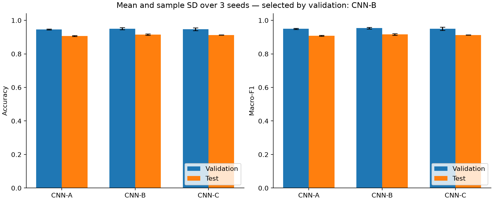
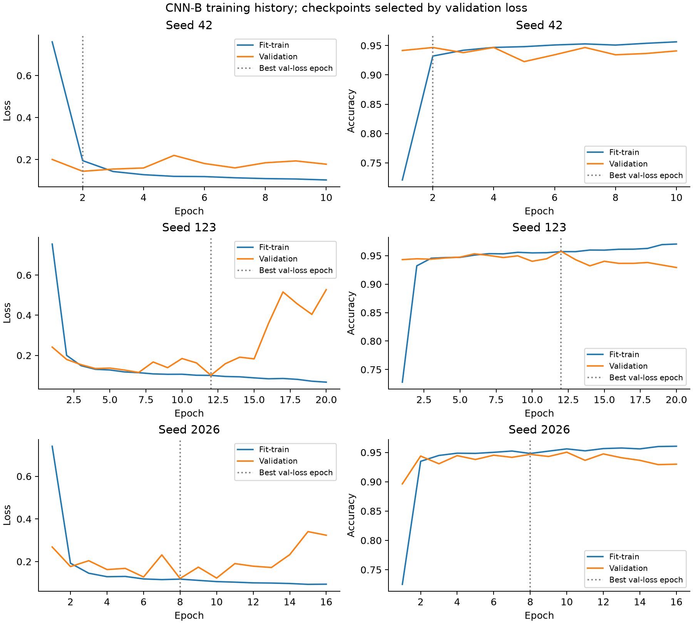
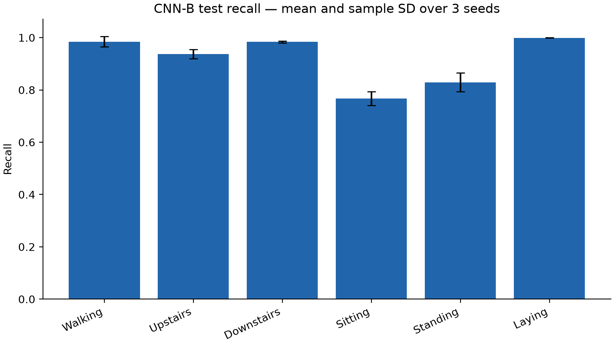
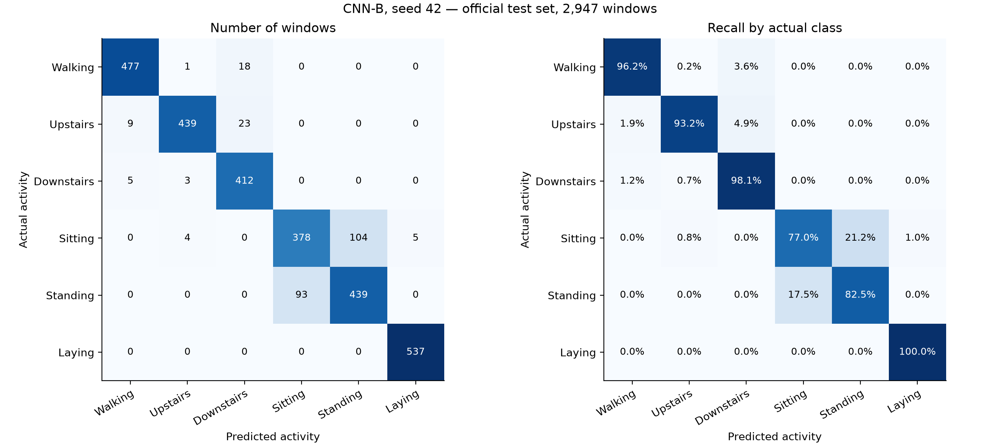
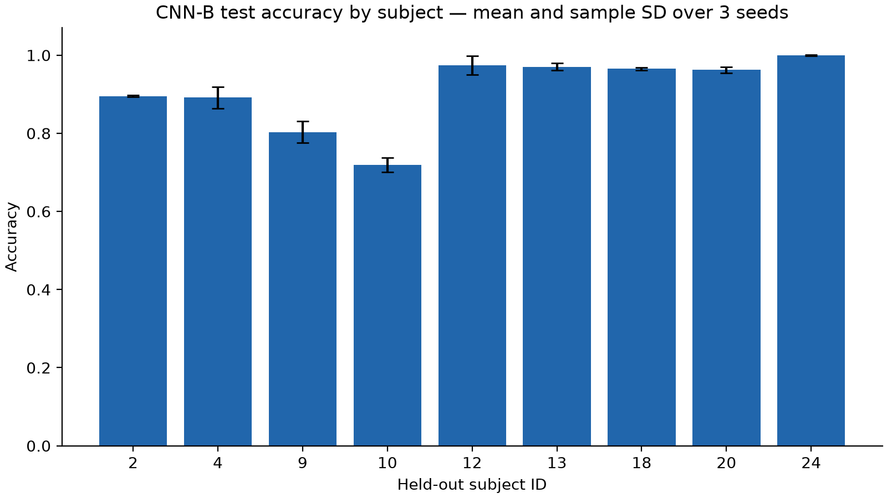

# Thiết kế thực nghiệm và kết quả nhận dạng hoạt động

Bản nội dung để ghép vào báo cáo chính. Kết quả lấy từ chín lượt đã khóa trong `results/protocol_lock.json`; mỗi lượt đánh giá cùng 2.947 cửa sổ test chính thức. Mô hình đại diện CNN-B được chọn bằng validation trước khi tính điểm test. Các độ lệch chuẩn dưới đây là độ lệch chuẩn mẫu qua ba seed (`ddof=1`).

## Chương 4 Thiết kế thực nghiệm tái hiện một phần

### 4.1 Mục tiêu và cách tiếp cận

Thực nghiệm kiểm tra khả năng áp dụng CNN một chiều cho phân loại sáu hoạt động từ tín hiệu smartphone, đồng thời khảo sát lỗi theo hoạt động và ảnh hưởng của ba cấu hình kiến trúc. E1 gồm CNN-B và baseline dự đoán lớp phổ biến nhất. E2 bổ sung CNN-A và CNN-C, dùng cùng dữ liệu, split và các seed để đối chiếu kết quả.

Đây là tái hiện một phần nguyên lý học đặc trưng tự động của Ronao và Cho (2016), không phải sao chép toàn bộ mô hình gốc. Đầu vào nhóm có chín kênh thay cho sáu kênh được bài gốc mô tả; mạng nhỏ hơn, dùng GAP và Adam, có giới hạn epoch và cách tạo validation công khai. Những khác biệt này được giữ rõ khi đối chiếu kết quả.

### 4.2 Dữ liệu và cách chia theo người

UCI HAR cung cấp tín hiệu gia tốc tổng, gia tốc cơ thể và vận tốc góc, mỗi loại ba trục. Nhóm ghép các kênh theo thứ tự body acceleration X/Y/Z, gyroscope X/Y/Z và total acceleration X/Y/Z. Mỗi cửa sổ có 128 thời điểm, tương đương 2,56 giây ở 50 Hz; các cửa sổ đã được dataset tiền xử lý và phân đoạn. Nhãn nguồn 1–6 được đổi thành 0–5 cho loss, nhưng giữ tên hoạt động khi xuất kết quả.

Không trộn ngẫu nhiên các cửa sổ để tạo validation. Bốn người 5, 11, 19 và 26 được dành làm validation trước huấn luyện; những người còn lại trong train chính thức dùng để cập nhật trọng số. Test chính thức được giữ nguyên. Kiểm tra ID xác nhận không có người xuất hiện đồng thời trong hai tập.

| Tập | Người tham gia | Cửa sổ | Vai trò |
|---|---:|---:|---|
| Fit-train | 17 | 5.982 | Fit chuẩn hóa, học trọng số, chọn lớp baseline |
| Validation | 4 | 1.370 | Early stopping và lựa chọn cấu hình |
| Test | 9 | 2.947 | Đánh giá cuối sau khi khóa quyết định |

Mọi tập có đủ sáu lớp. Dữ liệu được kiểm tra số dòng, độ dài cửa sổ, nhãn, subject và NaN/Inf trước khi huấn luyện. Với từng kênh, mean và standard deviation được tính trên hai trục mẫu/thời gian của fit-train, sau đó áp dụng nguyên trạng cho validation và test. Tính thống kê bằng `float64`, chặn standard deviation tối thiểu ở `1e-8`, chuyển đầu vào mạng về `float32`.

Quy trình này tránh sử dụng thông tin người validation/test để fit chuẩn hóa. Nhóm giữ lại toàn bộ index, thống kê và SHA-256 các tệp dữ liệu. Trong phiên bản thực nghiệm này không có bước huấn luyện lại trên toàn bộ 7.352 mẫu train sau lựa chọn; vì vậy số mẫu thực sự cập nhật trọng số thấp hơn số train chính thức của dataset.

### 4.3 Kiến trúc và các điều kiện giữ nguyên

| Cấu hình | Các lớp tích chập và pooling | Phần phân loại | Số tham số |
|---|---|---|---:|
| CNN-A | Conv64/k5 → MaxPool2 | GAP → Dense64 → Dropout0,3 → Softmax6 | 7.494 |
| CNN-B | Conv64/k5 → MaxPool2 → Conv128/k3 | Giống CNN-A | 36.294 |
| CNN-C | Conv64/k5 → MaxPool2 → Conv128/k3 → Conv128/k3 | Giống CNN-A | 85.574 |

Mọi Conv dùng ReLU và padding `same`; Dense64 cũng dùng ReLU. Ba cấu hình cùng optimizer Adam, learning rate 0,001, batch size 64, loss sparse categorical cross-entropy và tối đa 50 epoch. Early stopping theo validation loss với patience 8; checkpoint tốt nhất theo cùng thước đo được lưu và nạp lại để đánh giá. Phần fit-train được xáo trộn theo seed, validation giữ nguyên.

Mỗi cấu hình chạy độc lập với seed 42, 123 và 2026, tổng chín lượt chính thức. Một lượt thử một epoch được lưu riêng và không đưa vào bảng chính. Mỗi lượt khởi tạo lại trọng số/optimizer, đặt seed cho Python, NumPy và TensorFlow và bật toán tử quyết định được. Môi trường thực tế là Python 3.12, TensorFlow 2.21.0 trên CPU; phiên bản thư viện và thông tin thiết bị nằm trong `environment.json` của từng lượt.

Việc tăng lớp đồng thời làm đổi số tham số và receptive field. Do đó, E2 là so sánh ba cấu hình có độ sâu khác nhau, không phải phép thử cô lập tác động nhân quả của riêng độ sâu. Thời gian chạy được ghi để mô tả chi phí quan sát trong môi trường này; số epoch dừng và tải hệ thống cũng ảnh hưởng thời gian.

### 4.4 Baseline và thước đo

Baseline dự đoán lớp phổ biến nhất trong fit-train. Với split đã chọn, đó là lớp nằm, xuất hiện 1.139 lần trong 5.982 mẫu. Baseline được xác định trước khi xem kết quả test, không chọn lại theo phân bố test.

Accuracy đo tỷ lệ dự đoán đúng trên toàn bộ cửa sổ. Precision, Recall và F1 được tính riêng cho sáu hoạt động; Macro-F1 là trung bình F1 của sáu lớp với trọng số bằng nhau. Confusion matrix có hàng là lớp thật, cột là lớp dự đoán. Bản chuẩn hóa theo hàng hỗ trợ đọc Recall. Khi một lớp không được mô hình dự đoán, nhóm dùng quy ước `zero_division=0` và giữ đủ sáu lớp trong trung bình.

Nhóm báo cáo từng seed trước khi tính trung bình và độ lệch chuẩn mẫu. Không chọn lần chạy tốt nhất làm đại diện cho toàn bộ cấu hình. Ba seed cùng dùng một test, nên không coi đó là ba bộ dữ liệu độc lập và không nhân số mẫu test thành 8.841 khi mô tả dữ liệu.

### 4.5 Khóa quyết định trước test và kiểm tra tái lập

Sau chín lượt, nhóm so sánh Macro-F1 validation trung bình. Quy tắc định trước là làm tròn trung bình tới bốn chữ số thập phân; nếu hòa thì ưu tiên ít tham số hơn. CNN-B có giá trị cao nhất và được chọn. Việc này diễn ra trước thời điểm bắt đầu đánh giá test, được lưu trong lock cùng danh sách seed và checkpoint.

| Cấu hình | Accuracy validation trung bình | Macro-F1 validation trung bình | SD Macro-F1 |
|---|---:|---:|---:|
| CNN-A | 94,5742% | 0,949397 | 0,003311 |
| CNN-B | 95,0365% | 0,953502 | 0,005187 |
| CNN-C | 94,6715% | 0,949845 | 0,009245 |

Trước khi viết lock, từng checkpoint được nạp lại, kiểm tra tên/kiến trúc/số tham số và chạy lại trên validation. Toàn bộ xác suất dự đoán được so với tệp validation đã lưu để phát hiện checkpoint bị thay thế hoặc không khớp bằng chứng lựa chọn. Sau đó, lock ghi SHA-256 của dữ liệu, mã, protocol và các tệp của đủ chín lượt.

Đánh giá test chỉ chạy khi lock hợp lệ và chưa có đợt đánh giá trước. Mỗi lượt lưu dự đoán theo index test gốc, subject, nhãn thật, nhãn dự đoán và sáu xác suất. Bảng chỉ số được tính lại từ CSV để đối chiếu. Lệnh `python -m har_project verify` chỉ xác minh tệp và tính lại chỉ số từ dự đoán, không chạy lại suy luận hoặc huấn luyện.

## Chương 5 Kết quả thảo luận và phản biện

### 5.1 Kết quả tổng thể trên test

| Phương pháp | Số lượt | Accuracy test | Macro-F1 test | Thời gian train trung bình |
|---|---:|---:|---:|---:|
| Lớp phổ biến nhất | 1 | 18,2219% | 0,051378 | Không huấn luyện mạng |
| CNN-A | 3 | 90,6911% ± 0,3079 điểm % | 0,908219 ± 0,003023 | 29,41 giây |
| CNN-B | 3 | 91,5281% ± 0,4519 điểm % | 0,916081 ± 0,004601 | 35,14 giây |
| CNN-C | 3 | 91,2566% ± 0,0784 điểm % | 0,912694 ± 0,000926 | 71,79 giây |

Nguồn: `results/metrics_summary.csv` và `baseline_test_metrics.json`. Các giá trị “±” của Accuracy là điểm phần trăm; các giá trị “±” của Macro-F1 dùng thang 0–1. Thời gian được đo ở các lượt thực tế, không phải benchmark phần cứng có kiểm soát tải hệ thống.

CNN-B, cấu hình đã chọn trước bằng validation, cũng có trung bình test cao nhất trong ba cấu hình thử. Trung bình Accuracy cao hơn CNN-A khoảng 0,8370 điểm phần trăm và CNN-C khoảng 0,2715 điểm phần trăm. Tăng từ hai lên ba lớp không cho cải thiện trong thiết lập này. Chênh lệch nhỏ và chỉ có ba seed trên một split; chưa có cơ sở kết luận có ý nghĩa thống kê hoặc mô hình hai lớp tối ưu cho mọi trường hợp HAR.

### 5.2 Kết quả từng seed và vai trò checkpoint

| Cấu hình | Seed | Epoch chạy / checkpoint | Accuracy test | Macro-F1 test |
|---|---:|---:|---:|---:|
| CNN-A | 42 | 19 / 11 | 91,0417% | 0,911631 |
| CNN-A | 123 | 17 / 9 | 90,4649% | 0,905878 |
| CNN-A | 2026 | 19 / 11 | 90,5667% | 0,907147 |
| CNN-B | 42 | 10 / 2 | 91,0078% | 0,910806 |
| CNN-B | 123 | 20 / 12 | 91,7543% | 0,918174 |
| CNN-B | 2026 | 16 / 8 | 91,8222% | 0,919264 |
| CNN-C | 42 | 11 / 3 | 91,3471% | 0,913749 |
| CNN-C | 123 | 11 / 3 | 91,2114% | 0,912320 |
| CNN-C | 2026 | 10 / 2 | 91,2114% | 0,912013 |

Các learning curves CNN-B cho thấy loss train tiếp tục giảm trong khi loss validation có thể tăng ở những epoch sau. Vì thế checkpoint không trùng epoch cuối. Ví dụ seed 123 chạy 20 epoch nhưng mô hình được lấy tại epoch 12. Chỉ số test trong bảng là từ checkpoint có validation loss tốt nhất, không phải mô hình lựa chọn theo Accuracy test.

Accuracy validation trung bình của CNN-B là 95,0365%, trong khi test là 91,5281%, chênh khoảng 3,51 điểm phần trăm. Validation chỉ gồm bốn người và test gồm chín người khác; kết quả cho thấy mức đo được trên validation chưa đại diện hoàn toàn cho những người giữ lại trong test. Chênh lệch phù hợp với giới hạn khái quát hóa theo người, nhưng riêng thực nghiệm này chưa xác định được phần đóng góp của từng nguyên nhân như cách thực hiện động tác, hướng thiết bị hay khác biệt tín hiệu.

### 5.3 Phân tích từng hoạt động

Các giá trị dưới đây là trung bình từng chỉ số theo lớp qua ba seed CNN-B. Support là số cửa sổ thật của mỗi lớp trên cùng test, không cộng dồn ba lần.

| Hoạt động | Precision | Recall | F1 | Support |
|---|---:|---:|---:|---:|
| Đi bộ | 0,973151 | 0,984543 | 0,978641 | 496 |
| Lên cầu thang | 0,974340 | 0,937721 | 0,955351 | 471 |
| Xuống cầu thang | 0,938339 | 0,983333 | 0,960211 | 420 |
| Ngồi | 0,807860 | 0,767142 | 0,786342 | 491 |
| Đứng | 0,813739 | 0,828947 | 0,820579 | 532 |
| Nằm | 0,991381 | 0,999379 | 0,995363 | 537 |

Nguồn: các dòng CNN-B trong `results/test_class_metrics.csv`. Nhóm hoạt động ngồi và đứng có Recall/F1 thấp rõ rệt hơn bốn hoạt động còn lại. Vì vậy Accuracy tổng thể trên 91% che khuất một phần hạn chế ở các tư thế tĩnh. Macro-F1 và bảng từng lớp giúp mô tả khác biệt này.

Hình confusion matrix dùng seed 42 đã định trước, không chọn lại seed có hình dễ giải thích nhất. Trong lượt này, có 104 cửa sổ ngồi bị dự đoán đứng và 93 cửa sổ đứng bị dự đoán ngồi, tổng 197 trong 265 dự đoán sai, khoảng 74,3%. Cặp ngồi–đứng cũng đứng đầu ở seed 123 và 2026, lần lượt 190 và 189 lỗi hai chiều. Điều này hỗ trợ H2 trong phạm vi thực nghiệm của nhóm.

### 5.4 Phân tích theo người tham gia

| ID người test | Cửa sổ | Accuracy CNN-B trung bình qua seed |
|---:|---:|---:|
| 2 | 302 | 89,5143% |
| 4 | 317 | 89,1693% |
| 9 | 288 | 80,3241% |
| 10 | 294 | 71,8821% |
| 12 | 320 | 97,3958% |
| 13 | 327 | 97,0438% |
| 18 | 364 | 96,5201% |
| 20 | 354 | 96,2335% |
| 24 | 381 | 99,9125% |

Nguồn: `results/test_subject_metrics.csv`. Các số là phân tích mô tả sau đánh giá, không phải tiêu chí chọn mô hình. ID 10 có trung bình thấp nhất, trong khi ID 24 gần 100%. Không có đủ thông tin để quy lỗi cho cá nhân hoặc suy ra nguyên nhân hành vi cụ thể. Kết quả cho thấy nên xem xét hiệu quả theo người thay vì chỉ dùng một trung bình theo cửa sổ.

### 5.5 Đánh giá giả thuyết

| Giả thuyết | Kết quả và giới hạn |
|---|---|
| H1: CNN-B vượt baseline lớp phổ biến | Được hỗ trợ về mặt mô tả: cả ba seed đều vượt baseline trên Accuracy và Macro-F1 test. Baseline này yếu; chưa đủ kết luận CNN tốt hơn SVM/Random Forest |
| H2: Ngồi–đứng là cặp nhầm nổi bật | Được hỗ trợ: cặp này có số lỗi hai chiều lớn nhất ở cả ba seed CNN-B |
| H3: Kết quả thay đổi giữa các cấu hình | Quan sát được khác biệt trung bình và chi phí; CNN-B cao nhất. Chưa kiểm định ý nghĩa thống kê; số tham số và receptive field cũng thay đổi |
| H4: CNN cạnh tranh với SVM | Chưa kiểm chứng, do E3 không được thực hiện |

Độ lệch chuẩn qua seed phản ánh độ biến động tối ưu hóa trên cùng một split. Nó không phải khoảng tin cậy của hiệu quả trên dân số và không thay thế đánh giá trên nhiều nhóm người. Các cửa sổ chồng lấn cũng không phải những quan sát độc lập hoàn toàn.

### 5.6 Đối chiếu với Ronao và Cho

Ronao và Cho báo cáo 94,79% cho CNN kết hợp MLP với tín hiệu cảm biến và 95,75% cho một cấu hình có thêm tFFT, tại Bảng 5 của bài gốc. CNN-B của nhóm đạt 91,5281% test trung bình. Chênh lệch này không được diễn giải như thất bại xác nhận bài báo hoặc chứng minh mô hình gốc vượt trội dưới điều kiện giống nhau, vì các điều kiện thực nghiệm khác nhau.

Nhóm dùng chín kênh, CNN 64–128, GAP, Dense64, Adam và tối đa 50 epoch; bài gốc mô tả sáu kênh, kiến trúc tốt 96–192–192–1000–6 và quy trình tối ưu hóa/khảo sát khác. Fit-train nhóm còn 5.982 mẫu sau khi dành người validation. Thông tin validation và phạm vi fit chuẩn hóa của bài gốc chưa đủ để khẳng định hoàn toàn tương đương.

Phân tích lỗi cũng khác: trong Bảng 3 của bài gốc, lớp nằm có Recall 87,71%, thấp nhất; trong CNN-B của nhóm, nằm gần như được nhận dạng hoàn toàn, còn ngồi–đứng là khó khăn chính. Gia tốc tổng chứa thông tin liên quan tới tư thế có thể góp phần tạo khác biệt, nhưng đây chỉ là diễn giải có khả năng; nhóm chưa làm ablation 6/9 kênh để kiểm tra nguyên nhân đó. Không dùng sự khác biệt này để kết luận thêm kênh luôn cải thiện mô hình.

Nguồn đối chiếu chi tiết: [bảng công trình gốc và thiết kế nhóm](../docs/research/original-vs-reproduction.md), [bảng dẫn chứng](../docs/research/literature-matrix.md) và [bài gốc](../Paper/Human_activity_recognition_with_smartpho.pdf).

### 5.7 Hạn chế và bài học phương pháp

Thực nghiệm chỉ dùng một dataset, sáu hoạt động và một split người validation/test. Số người giữ lại để đánh giá còn ít; mỗi cấu hình chỉ có ba seed. Nhóm chưa khảo sát thiết bị, vị trí đeo hoặc bối cảnh ngoài dataset, chưa chạy baseline truyền thống mạnh và chưa cô lập ảnh hưởng từng kênh tín hiệu. Các giới hạn này ngăn suy rộng từ Accuracy hiện có tới độ tin cậy sử dụng thực tế.

Sau khi xem kết quả test, nhóm không đổi learning rate, dropout, số lớp hoặc danh sách seed để cải thiện điểm trên cùng test. Phân tích lỗi và hiệu quả theo người hỗ trợ thảo luận, nhưng nếu dùng chúng để thiết kế cải tiến thì các cải tiến cần một quy trình đánh giá mới. Giá trị phương pháp luận của đồ án là ghi quyết định trước đánh giá, giữ bằng chứng từng lượt, công khai các khác biệt và giới hạn kết luận theo dữ liệu đã quan sát.

## Kết luận dự kiến để phát triển Chương 6

CNN 1D giản lược học được biểu diễn phân biệt sáu hoạt động và vượt baseline lớp phổ biến nhất trên test người giữ lại. CNN-B đạt Accuracy trung bình 91,53%, Macro-F1 0,9161; hạn chế tập trung ở ngồi–đứng và một số người test. Ba cấu hình không cho xu hướng cải thiện đơn điệu theo độ sâu, còn việc đối chiếu bài gốc chịu giới hạn bởi sự khác nhau về biểu diễn và huấn luyện.

Hướng tiếp theo có thể gồm đánh giá nhiều split người, baseline SVM trên 561 đặc trưng, ablation 6/9 kênh và mô hình có thành phần tuần tự. Đây là các hướng nghiên cứu tiếp, chưa phải kết quả đã thực hiện của đồ án hiện tại.
